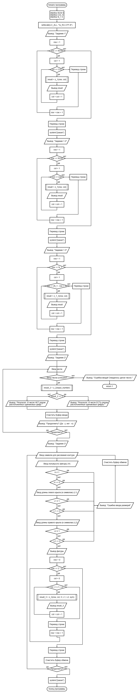
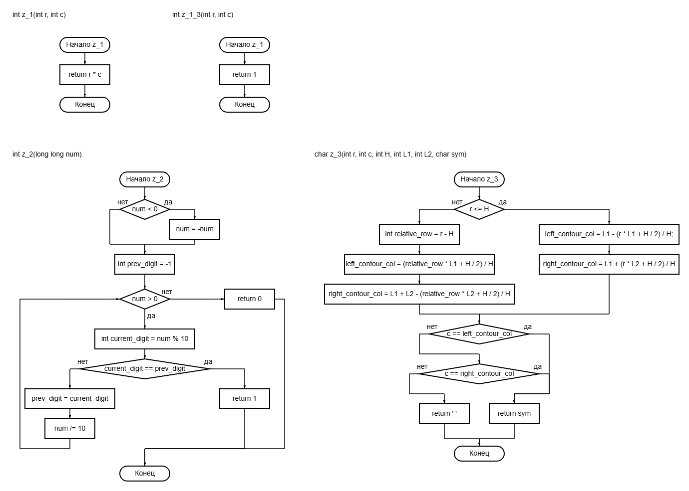
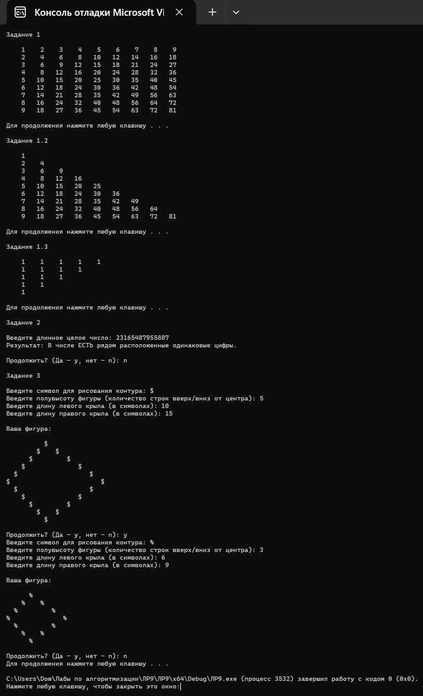

# Лабораторная работа 9

## Цель работы
Закрепление навыков использования циклов

## Блок-схема

## Результаты работы программы

## Информация о разработчике
Орлова Эльвира Эдуардовна
Группа: бИД-261
